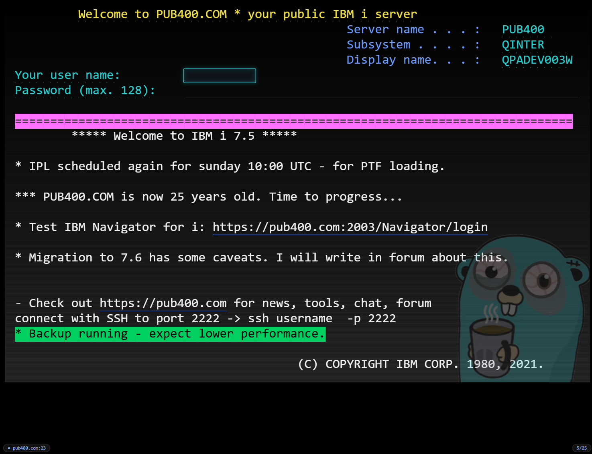
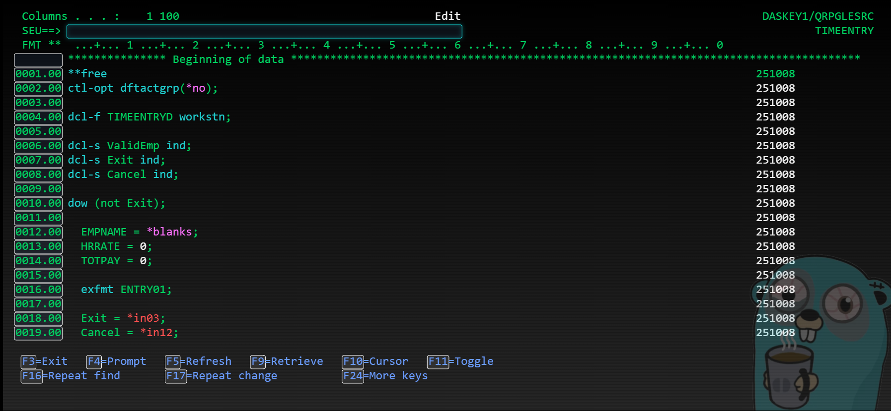
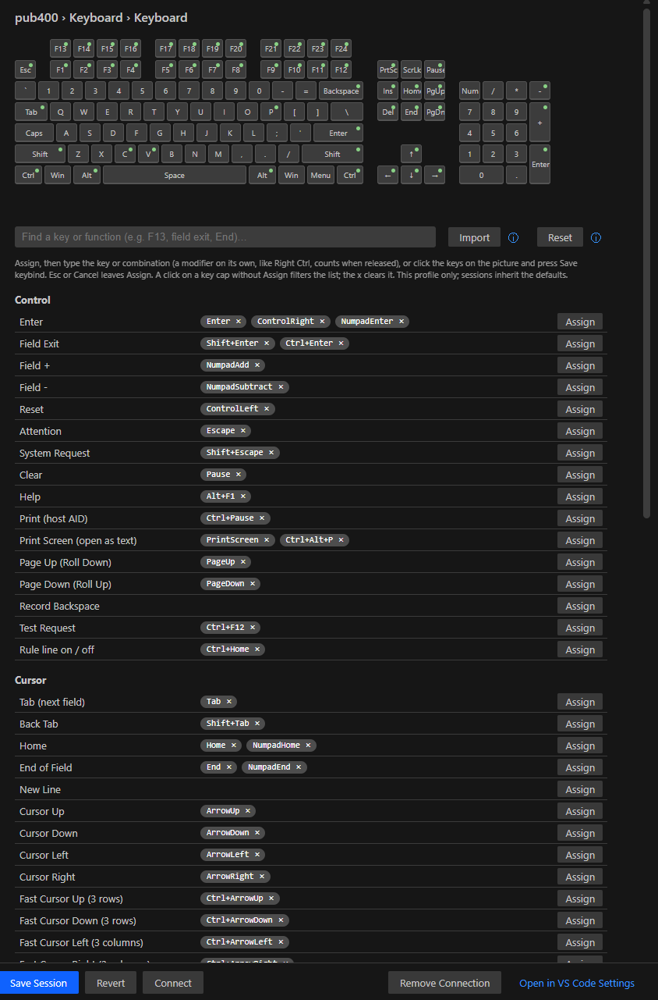

# TN5250 Terminal for IBM i

[](https://marketplace.visualstudio.com/items?itemName=DerKyberTakt.tn5250-terminal) [](https://marketplace.visualstudio.com/items?itemName=DerKyberTakt.tn5250-terminal) [](https://marketplace.visualstudio.com/items?itemName=DerKyberTakt.tn5250-terminal&ssr=false#review-details) [](https://github.com/DerKyberTakt/tn5250-terminal/actions/workflows/ci.yml) [](LICENSE)

A 5250 terminal emulator that lives in a **VS Code editor tab**. Connect to IBM i (AS/400, iSeries) systems next to your RPG, CL and SQL sources, with the keyboard and look of IBM i Access Client Solutions and nothing else to install.

## Screenshots

Sign On on PUB400 in the Enhanced look, with the watermark and status line:



SEU in 27x132 with syntax colouring and function keys drawn as buttons:



The Keyboard settings page with the visual keyboard:



## Highlights

- **Zero installs.** A pure TypeScript TN5250 client running inside VS Code. No Java, no Node runtime, no packages on the IBM i.
- **Fits the tab.** The screen scales to the editor area; zoom with Ctrl+wheel. 24x80 and 27x132, switching automatically as the host does.
- **ACS keyboard.** F1–F24, Field Exit, Field+/−, Attn, SysReq, Reset, Dup, Erase Input, Fast Cursor, Tab Word, Test Request, insert mode and the 5250 operator error codes. Assign any key to any function by typing it or clicking it on a picture of the keyboard, or import an ACS `.kmp` keyboard map.
- **Classic or Enhanced look.** The familiar green screen, or a modern mode with a gradient background, outlined input fields, glowing text and function keys drawn as buttons. Every colour is yours to change, with import and export of colour schemes.
- **Enhanced 5250 interface.** The terminal answers the host's Query as an enhanced display, so DDS windows arrive as GUI windows with their titles, subfiles compiled with `SFLEND(*SCRBAR)` get a scroll bar you can click and drag, and menu bars, pull-downs, radio buttons, check boxes, selection lists and push buttons work with the keyboard and the mouse, as in ACS. Continued entry fields, word wrap, cursor progression, highlighted entry fields, Write Data and programmable mouse buttons are handled too. An optional scroll bar beside every subfile (More... / Bottom) sends Page Up / Page Down. In the Enhanced look windows are frames with a shadow and the widgets are drawn; the Classic look shows what a character display shows.
- **Host PC commands.** `STRPCCMD` from a host program opens http(s) links in your browser; other commands ask first (or never run, by setting).
- **Connections side bar.** Saved connections with their open tabs underneath, connected ones first with a badge count, one-click tabs, session letters in the tab title, Connect to Previous (Ctrl+Alt+5), Duplicate, demo sessions with a tilted watermark and a coloured frame. A **History** view lists past connections (host, workstation name, user profile seen on the sign-on screen, start, end, duration) with Connect again; it can be turned off.
- **Settings page** modelled on ACS: Connection, Advanced, TLS/SSL, Display, Font, Watermark, Colors, Enhanced UI, Paste, Copy, Hotspots, Window Title, Tab Setup, Keyboard, Sound, Behavior, AI Agent. Searchable, with an information bubble on every setting and live previews. Saving a connection setting while its tab is open offers **Save & Reload**, which reconnects the tab with the new values.
- **Productivity.** Rectangle selection (mouse, Shift+Arrows, double-click a word or an input field) and copy, field-aware paste with tab handling, hotspots for function keys, menu numbers and URLs, find on screen (Ctrl+F), rule line, print screen (Ctrl+Alt+P), bypass sign-on with the password kept in the VS Code secret store.
- **Connectivity.** Telnet on port 23 or telnet over TLS (port 992) with certificate validation, optional client certificates, keep-alive, auto-reconnect, inactivity timeout, workstation ID templates (`&COMPN`, `&USERN`, `*`, `=`) with automatic retry when a name is in use.

## Getting started

1. Install the extension and open the **TN5250** view in the Activity Bar.
2. Click **New Connection**, enter the host name (port 23 is the default), and adjust anything else on the Settings page that opens.
3. Click the connection. A tab opens, connects and shows the Sign On screen. Sign on as usual.

Already have your systems in ACS or Code for IBM i? **Import Connections** (in the view's `...` menu, or the Command Palette) reads the ACS session profiles (`.hod`) from `Documents\IBM\iAccessClient\Emulator` or any folder you pick, or the Code for IBM i connection list, and adds the ones you select. From ACS it brings the connection (host, port, TLS, screen size, code page, workstation name, user profile, Bypass signon), auto-connect, auto-reconnect, keep-alive, the connection and inactivity timeouts, and the display, paste, hotspot, mouse wheel, sound and keyboard options that have a match here, field, screen and status line colors included; from Code for IBM i, the name, host and user profile. 5250 printer, 3270 and VT profiles are left out. A connection that is already saved is not touched without asking: you choose between updating it from the profile (the profile's values win, and what you set only here, such as a trusted certificate, stays) and leaving it as it is. Undo is offered after every import. Passwords are never imported: set them once with Set Password.

Useful commands (Command Palette, prefix **TN5250:**): Settings, New Tab (same session), Connect to Previous IBM i, Disconnect, Disconnect All, Print Screen, Find on Screen, Import Connections, Import ACS Keyboard Map, Macros, Record Macro, Run Macro, Save Session Trace.

**Macros**: the Macros view in the side bar lists them with play, pencil and trash on each row and New, Record, Import and Export on its title bar. TN5250: Record Macro records what you type and press in the active tab; TN5250: Stop Recording asks for a name and a key (a function key or a combination with Ctrl, Alt or Meta). The macro then runs from that key in any tab, or from TN5250: Run Macro. After Enter or a function key the macro waits for the host to accept input again. Passwords do not belong in a macro.

## Keyboard

| Key | 5250 function |
|---|---|
| Enter, Right Ctrl | Enter |
| Left Ctrl | Reset |
| Keypad Enter, Shift+Enter, Ctrl+Enter | Field Exit |
| Keypad +, Keypad − | Field+, Field− |
| F1–F12, Shift+F1–F12 | F1–F24 |
| Escape, Shift+Escape | Attn, SysReq |
| Page Up / Page Down, mouse wheel | Roll |
| Home, End | First field, Erase to end of field |
| Insert, Delete, Backspace | Insert mode, Delete, Backspace |
| Alt+End | Erase Input (Dup is unassigned by default, as in ACS) |
| Pause, Alt+F1 | Clear, Help |
| Ctrl+Arrows, Alt+Left / Alt+Right | Fast cursor (3 rows or columns), Tab Word / Backtab Word |
| Ctrl+Delete, Ctrl+F12, Ctrl+Home | Delete Word, Test Request, rule line on/off |
| Shift+Arrows, drag, double-click | Select; Ctrl+C or Ctrl+Insert copies (with no selection, the whole screen, as in ACS); Ctrl+V or Shift+Insert pastes |
| Ctrl+F | Find on screen: every match on the current screen is highlighted and the current one selected; in the box, Enter or F3 goes to the next match, Shift+Enter or Shift+F3 to the previous one, Alt+C matches case, Page Up / Page Down roll, Escape closes. Each new screen is searched again |

Any key combination with Ctrl, Alt or Win that the keymap does not use goes to VS Code (Ctrl+Shift+P, Ctrl+B, Ctrl+J, Ctrl+1–9 ...), as does Alt+F4. A bare Alt press belongs to the terminal, so Alt+Left / Alt+Right do not open the menu bar. Everything bound is remappable on the Keyboard page, which shows a picture of the keyboard: keys light up as you press them, bound keys carry a dot, and a click lists what a key does.

Known keyboard gaps: characters typed with AltGr are not passed through yet, and an ACS `.kmp` map cannot express Right Ctrl / Left Ctrl, so those two stay at their defaults after an import.

## Settings

All options are available on the Settings page and as ordinary VS Code settings under `tn5250.*`. "Defaults" apply to every tab; each saved connection stores only what differs from the defaults.

**Host code page** must be the CCSID the host reads your keystrokes with (`DSPSYSVAL QCCSID`, or the CCSID of your user profile; the same value an ACS session for that host uses). The default is 037. The emulator sends EBCDIC bytes and the host interprets them, so a wrong code page turns `!` into `Ü` or `]` without anything visible on a sign-on screen. See Troubleshooting. The single-byte EBCDIC pages offered: 037, 273, 277, 278, 280, 284, 285, 297, 500, 871 (Latin-1 by country), 870 and 1153 (Latin-2: Czech, Slovak, Polish, Hungarian, Croatian, Romanian ...), 875 (Greek), 1025 (Cyrillic), 1026 (Turkish) and the euro variants 1140-1149.

## Agent sessions (AI agents on the console terminal)

Step-by-step setup, from installing tn5250-tui to watching the agent work: [docs/AI-AGENT.md](docs/AI-AGENT.md).

[tn5250-tui](https://github.com/DerKyberTakt/tn5250-tui), the console version of this terminal, has an MCP server (`tn5250-tui mcp`) through which an AI agent such as Claude Code drives 5250 sessions. With `tn5250.agent.enabled` on, the **Agent Sessions** view lists the running servers (found through their token files) and the sessions each one holds, the title says how many are connected and the connected ones carry the green session icon; a click opens the session read-only in a VS Code terminal (`tn5250-tui attach`), and the row's buttons put that terminal in the editor area or in its own window so you can watch the agent work while you do something else. A server whose process has ended drops out of the list on its own; one that does not answer has a **Forget** button, and **Clean Up Agent Servers** forgets all of those at once. **TN5250: Set Up Claude Code** writes the workspace's `.mcp.json` for the site named in `tn5250.agent.site` (give the agent its own user profile and save it as a site in tn5250-tui); `tn5250.agent.readOnly` starts the server with `--read-only`. The **AI Agent** page of the Settings panel holds these settings, with **Enroll User for AI Agent** (one of your connections and your sign-on written as the agent's site), **Remove Agent Enrollment** and **Set Up Claude Code**, and shows which tn5250-tui was found, who is enrolled and whether the workspace `.mcp.json` starts the server.

The agent is best given a user profile of its own: the host then logs its work under that name and its authority is the fence. When that is not possible (a contractor who cannot get a second profile, say), **TN5250: Enroll User for AI Agent** saves one of your connections, with your user and password and bypass sign-on turned on, as the agent's site in tn5250-tui's sites file. It asks first and names the file, because the password leaves the VS Code secret store for the console terminal's sites file, where it stays in clear text until the next start of tn5250-tui or its MCP server moves it into the OS secret store (Credential Manager, Keychain, Secret Service); everything the agent does is then logged under your profile. Enrolling again on an enrolled site asks to **Replace** the current enrollment and names it. **TN5250: Remove Agent Enrollment** takes the site out again. Apart from that one command, nothing in this extension's own sessions or secret store is shared with the agent.

## Security and privacy

- Passwords and certificate passphrases are stored in the VS Code secret store, never in settings files, logs or traces (a saved trace blanks what was typed into non-display fields). The secret store is protected by the operating system keyring where there is one (Windows Credential Manager, macOS Keychain, a Secret Service keyring on Linux); on a Linux machine without a keyring, leave bypass sign-on off. Passwords are keyed by user profile and host, so a session never picks up another user's password.
- Bypass sign-on types the password only into a non-display field on the first screens after connect. Over plain telnet it travels unencrypted, like a typed sign-on; use TLS (port 992) where the host offers it. A refused TLS certificate shows its SHA-256 fingerprint and can be trusted for that session, or the signing CA can be given as a PEM file; TLS client certificates are experimental in the extension and not supported by the desktop app.
- TLS connections validate the host certificate by default; self-signed hosts can be allowed per connection.
- Imported fonts are copied into the extension's own storage and loaded only for the terminal. No telemetry, no network access other than the host you connect to.
- The History view keeps host, port, workstation name, user profile (read from the sign-on screen or the bypass sign-on setting), tab title and times in VS Code's global state on your machine. Never passwords or screen contents. `tn5250.history.enabled` turns it off, `tn5250.history.limit` caps it, and Clear History empties it.
- **Save Session Trace** writes the raw bytes of a session for troubleshooting. The file contains screen contents; share it only with people allowed to see them.

## Troubleshooting

### Sign-on fails with CPF1120, but the user ID and password are right

The password probably contains a character that is not the same in every EBCDIC code page: `! @ # $ [ ] { } | \\ ^ ~` and the accented letters. The emulator sends the byte of the character in the session's code page; the host reads that byte with the CCSID of the sign-on job (`QCCSID`, or the user profile's CCSID), and at password level 2 or 3 it checks the password as those characters. When the two code pages differ, `!` typed under 037 arrives as:

| Host CCSID | `!` arrives as |
|---|---|
| 037, 1140 | `!` |
| 273, 1141 (Germany/Austria) | `Ü` |
| 500, 1148 (International) | `]` |
| 1142 (Denmark/Norway) | `€` (and `#` as `Æ`) |
| 1144 (Italy) | `é` (and `#` as `£`) |

It works the other way round too: a password set from a 037 session fails from a 273 session. Nothing on the screen shows it, because the password field does not display, and from IBM i 7.5 the host answers CPF1120 ("user does not exist or password not correct") for both cases. Each failed attempt counts toward `QMAXSIGN`, so do not keep guessing.

- Set **Host Code Page** (Settings > Connection) to the host's CCSID and connect again. Use the value your ACS session has for that host, or ask for `QCCSID`.
- After a failed sign-on with such a password, the emulator shows a one-time hint that names the characters and the code page in use.
- The workstation is announced with the keyboard type and character set that belong to the code page (`KBDTYPE` AGB for 273, INB for 500, and so on; the Keyboard type setting overrides it), so the virtual device matches the code page.
- A password made of letters, digits and `.`, `-`, `_` is the same in every code page and avoids the problem when you sign on from several systems.
- **After upgrading to 0.2.7** a password with such characters may fail where it worked before. Versions up to 0.2.4 announced no code page unless a workstation ID was set, so the host read the keystrokes with its own default CCSID; a password set or changed through such a session holds those other characters (`Ü` for `!` on a German host). 0.2.6 announces the page, the host reads the characters as typed, and the stored password no longer matches. Reset the password once (the host's password reset, or `CHGUSRPRF` by an administrator) and set it again from the new version; it then matches what ACS and every other client send.

## Status

Version 0.2.2; see [CHANGELOG.md](CHANGELOG.md). Tested against IBM i 7.3 and 7.5 with text-mode screens, windows, subfiles and menus. The enhanced interface (scroll bars, selection fields, pull-downs, push buttons, continued entry fields, word wrap, cursor progression, programmable mouse buttons) follows the IBM 5494 Functions Reference and is covered by unit tests built from that specification; checking it against display files compiled with those DDS keywords is ongoing, so please report screens that look or behave wrong. Not implemented: grid lines, ideographic (DBCS) fields, printer sessions, file transfer. Client certificate authentication is implemented to specification but has not been verified against a host that requires it. The job number is not in the 5250 data stream, so the History view cannot show it.

## Building from source

```
npm install
npm run check      # typecheck, lint, tests
npm run package    # builds the .vsix
```

## License

MIT. See [LICENSE](LICENSE).
