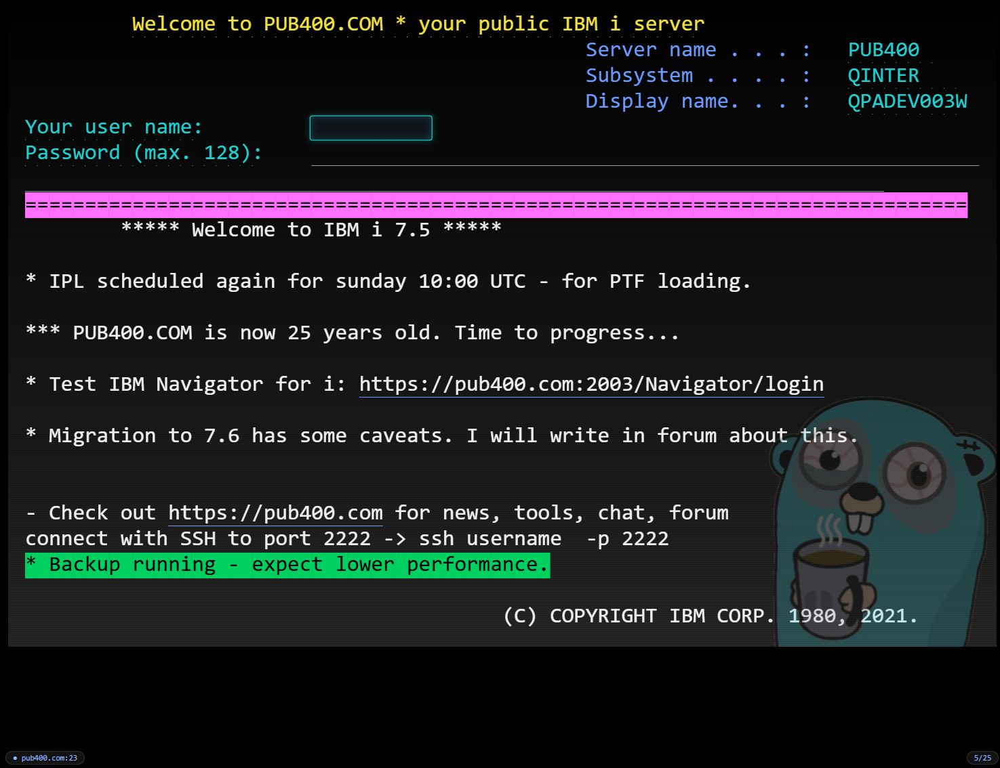
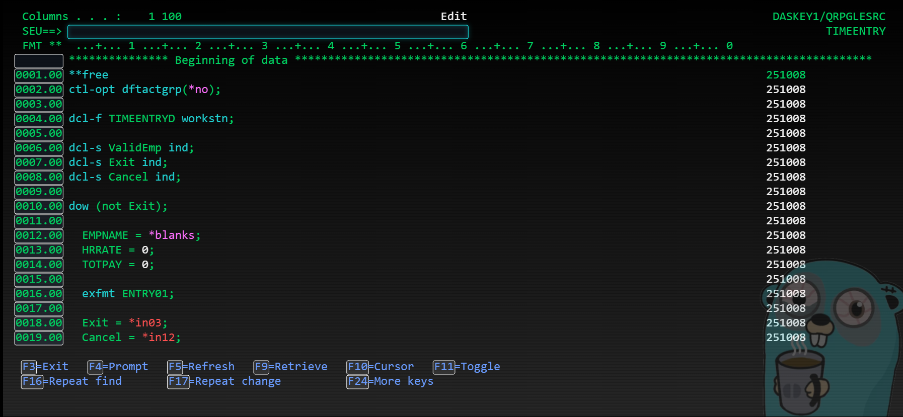
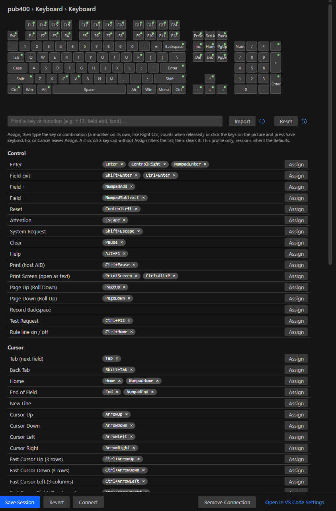

# TN5250 Terminal for IBM i

A 5250 terminal emulator that lives in a **VS Code editor tab**. Connect to IBM i (AS/400, iSeries) systems next to your RPG, CL and SQL sources, with the keyboard and look of IBM i Access Client Solutions and nothing else to install.

## Screenshots

Sign On on PUB400 in the Enhanced look, with the watermark and status line:



SEU in 27x132 with syntax colouring and function keys drawn as buttons:



The Keyboard settings page with the visual keyboard:



## Highlights

- **Zero installs.** A pure TypeScript TN5250 client running inside VS Code. No Java, no Node runtime, no packages on the IBM i.
- **Fits the tab.** The screen scales to the editor area; zoom with Ctrl+wheel. 24x80 and 27x132, switching automatically as the host does.
- **ACS keyboard.** F1–F24, Field Exit, Field+/−, Attn, SysReq, Reset, Dup, Erase Input, Fast Cursor, Tab Word, Test Request, insert mode and the 5250 operator error codes. Assign any key to any function by typing it or clicking it on a picture of the keyboard, or import an ACS `.kmp` keyboard map.
- **Classic or Enhanced look.** The familiar green screen, or a modern mode with a gradient background, outlined input fields, glowing text and function keys drawn as buttons. Every colour is yours to change, with import and export of colour schemes.
- **Connections side bar.** Saved connections with their open tabs underneath, connected ones first with a badge count, one-click tabs, session letters in the tab title, Connect to Previous (Ctrl+Alt+5), Duplicate, demo sessions with a tilted watermark and a coloured frame. A **History** view lists past connections (host, workstation name, user profile seen on the sign-on screen, start, end, duration) with Connect again; it can be turned off.
- **Settings page** modelled on ACS: Connection, Advanced, TLS/SSL, Display, Font, Watermark, Colors, Enhanced UI, Paste, Copy, Hotspots, Window Title, Tab Setup, Keyboard, Sound, Behavior. Searchable, with an information bubble on every setting and live previews. Saving a connection setting while its tab is open offers **Save & Reload**, which reconnects the tab with the new values.
- **Productivity.** Rectangle selection (mouse, Shift+Arrows, double-click a word or an input field) and copy, field-aware paste with tab handling, hotspots for function keys, menu numbers and URLs, rule line, print screen (Ctrl+Alt+P), bypass sign-on with the password kept in the VS Code secret store.
- **Connectivity.** Telnet on port 23 or telnet over TLS (port 992) with certificate validation, optional client certificates, keep-alive, auto-reconnect, inactivity timeout, workstation ID templates (`&COMPN`, `&USERN`, `*`, `=`) with automatic retry when a name is in use.

## Getting started

1. Install the extension and open the **TN5250** view in the Activity Bar.
2. Click **New Connection**, enter the host name (port 23 is the default), and adjust anything else on the Settings page that opens.
3. Click the connection. A tab opens, connects and shows the Sign On screen. Sign on as usual.

Useful commands (Command Palette, prefix **TN5250:**): Settings, New Tab (same session), Connect to Previous IBM i, Disconnect, Disconnect All, Print Screen, Import ACS Keyboard Map, Save Session Trace.

## Keyboard

| Key | 5250 function |
|---|---|
| Enter, Right Ctrl | Enter |
| Left Ctrl | Reset |
| Keypad Enter, Shift+Enter, Ctrl+Enter | Field Exit |
| Keypad +, Keypad − | Field+, Field− |
| F1–F12, Shift+F1–F12 | F1–F24 |
| Escape, Shift+Escape | Attn, SysReq |
| Page Up / Page Down, mouse wheel | Roll |
| Home, End | First field, Erase to end of field |
| Insert, Delete, Backspace | Insert mode, Delete, Backspace |
| Alt+End | Erase Input (Dup is unassigned by default, as in ACS) |
| Pause, Alt+F1 | Clear, Help |
| Ctrl+Arrows, Alt+Left / Alt+Right | Fast cursor (3 rows or columns), Tab Word / Backtab Word |
| Ctrl+Delete, Ctrl+F12, Ctrl+Home | Delete Word, Test Request, rule line on/off |
| Shift+Arrows, drag, double-click | Select; Ctrl+C or Ctrl+Insert copies (with no selection, the whole screen, as in ACS); Ctrl+V or Shift+Insert pastes |

Any key combination with Ctrl, Alt or Win that the keymap does not use goes to VS Code (Ctrl+Shift+P, Ctrl+B, Ctrl+J, Ctrl+1–9 ...), as does Alt+F4. A bare Alt press belongs to the terminal, so Alt+Left / Alt+Right do not open the menu bar. Everything bound is remappable on the Keyboard page, which shows a picture of the keyboard: keys light up as you press them, bound keys carry a dot, and a click lists what a key does.

Known keyboard gaps: characters typed with AltGr are not passed through yet, and an ACS `.kmp` map cannot express Right Ctrl / Left Ctrl, so those two stay at their defaults after an import.

## Settings

All options are available on the Settings page and as ordinary VS Code settings under `tn5250.*`. "Defaults" apply to every tab; each saved connection stores only what differs from the defaults.

## Security and privacy

- Passwords and certificate passphrases are stored in the VS Code secret store, never in settings files.
- TLS connections validate the host certificate by default; self-signed hosts can be allowed per connection.
- Imported fonts are copied into the extension's own storage and loaded only for the terminal. No telemetry, no network access other than the host you connect to.
- The History view keeps host, port, workstation name, user profile (read from the sign-on screen or the bypass sign-on setting), tab title and times in VS Code's global state on your machine. Never passwords or screen contents. `tn5250.history.enabled` turns it off, `tn5250.history.limit` caps it, and Clear History empties it.
- **Save Session Trace** writes the raw bytes of a session for troubleshooting. The file contains screen contents; share it only with people allowed to see them.

## Status

Version 0.1.6; see [CHANGELOG.md](CHANGELOG.md). Tested against IBM i 7.3 and 7.5 with text-mode screens, windows, subfiles and menus. The terminal answers the host's Query as an enhanced-interface display, so DDS windows arrive as GUI windows and are drawn, saved and restored as in ACS. Not yet implemented: the rest of the enhanced interface (scroll bars, selection fields and pull-downs, unrestricted cursor), printer sessions, file transfer. Client certificate authentication is implemented to specification but has not been verified against a host that requires it. The job number is not in the 5250 data stream, so the History view cannot show it.

## Building from source

```
npm install
npm run check      # typecheck, lint, tests
npm run package    # builds the .vsix
```

## License

MIT. See [LICENSE](LICENSE).
